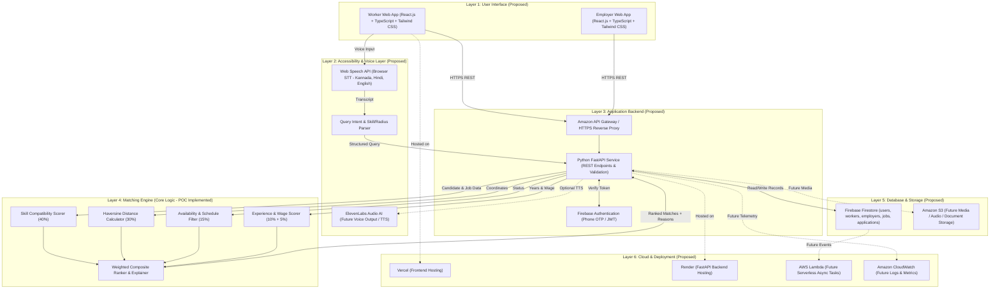

# KAAMCONNECT

**Local Skills. Local Jobs. Better Opportunities.**

[](docs/implementation-roadmap.md)
[](poc/matching_engine.py)
[](LICENSE)
[](.github/workflows/ci.yml)

KaamConnect is a documentation-first system architecture and proof-of-concept repository for a **hyper-local, voice-enabled job matching platform** designed to connect informal and semi-skilled workers with nearby employers and small businesses in non-metropolitan and semi-urban areas.

> **Repository Scope:** This repository focuses on complete software architecture, system workflows, database & API specifications, and a working Python matching-engine proof of concept (`poc/`). It intentionally does **not** implement a full production web application or live cloud deployment.

---

## Problem Statement

**Problem Statement 4: Hyper-Local Job Matching for Informal & Semi-Skilled Workers**

> Job seekers in non-metropolitan areas often struggle to find nearby employment opportunities because most existing job platforms primarily focus on white-collar professionals.
>
> Informal and semi-skilled workers, such as electricians, plumbers, carpenters, masons, painters, construction workers, and daily-wage labourers, lack access to reliable, location-based job opportunities.
>
> The challenge is to develop a hyper-local, voice-enabled job matching platform that connects informal and semi-skilled workers with nearby employers and small businesses through a simple, accessible digital interface.

---

## The Problem We Address

In Tier-2, Tier-3, and semi-urban communities, millions of skilled tradespeople and daily-wage earners rely on physical labour chowks, word-of-mouth, or informal middlemen to find work:

- **Electricians & Plumbers:** Struggle to advertise immediate availability for urgent residential or shop repairs within a 3–10 km radius.
- **Carpenters & Painters:** Face irregular seasonal demand and lack visibility into nearby household renovation jobs.
- **Masons & Construction Workers:** Travel long distances without guaranteed work or transparent daily wages.
- **Daily-Wage Labourers:** Excluded by English-only, resume-centric white-collar job portals that require formal CVs, email IDs, and multi-week hiring cycles.

See [docs/problem-statement.md](docs/problem-statement.md) for a detailed breakdown.

---

## Our Proposed Solution

KaamConnect bridges this gap through five design pillars:

1. **Hyperlocal Discovery:** Uses GPS coordinates (with manual town/pincode fallback) and the Haversine formula to match jobs within a practical commuting radius.
2. **Skill-Based Matching:** Replaces formal resumes with structured trade skill tags (`wiring`, `pipe_fitting`, `plastering`, etc.) and transparent multi-factor scoring.
3. **Voice-Enabled Interaction:** Proposes browser-based speech recognition (**Web Speech API**) so workers can speak queries naturally instead of typing.
4. **Regional-Language Accessibility:** Designed for **Kannada**, **Hindi**, and **English** interfaces and voice queries.
5. **Simple Digital Interfaces:** Mobile-first, low-bandwidth UI tailored for first-time smartphone users.

---

## Key Features (Proposed vs. POC)

> **Transparency Note:** Features marked **POC Implemented** are demonstrated in [`poc/matching_engine.py`](poc/matching_engine.py). All other features are **proposed** architectural designs for the MVP and future phases.

| # | Feature | Description | Status |
| :--- | :--- | :--- | :--- |
| 1 | **Hyperlocal Job Discovery** | Radius-based matching using Haversine geographic distance | POC Implemented |
| 2 | **Skill-Based Matching** | Weighted scoring across skills, distance, availability, experience, and wage | POC Implemented |
| 3 | **Nearby Worker Discovery** | Ranked list of local available workers for an employer's job | POC Implemented |
| 4 | **Voice-Based Job Search** | Spoken queries via Web Speech API (e.g., *"Show plumbing jobs within 5 km"*) | Proposed |
| 5 | **Regional-Language Support** | Kannada, Hindi, and English localization | Proposed |
| 6 | **Worker Profiles** | Phone-first profile with trade skills, expected wage, and availability | Proposed |
| 7 | **Employer Job Postings** | Quick job creation with required skills and offered daily wage | Proposed |
| 8 | **Direct Communication** | Contact handoff after mutual match/application acceptance | Proposed |
| 9 | **Application Management** | Apply, review, accept, or reject workflows | Proposed |

---

## How It Works

### Worker Workflow
1. Register with a mobile number and preferred language (Kannada, Hindi, or English).
2. Select trade skills, expected daily wage, and current availability.
3. Share location via Browser Geolocation (or enter town/pincode if permission is denied).
4. Search jobs using **voice** or **text**.
5. Review ranked nearby jobs with distance and match reasons, apply, and contact the employer upon acceptance.

### Employer Workflow
1. Register and create a local business or household employer profile.
2. Post a job with required trade skills, offered daily wage, and job-site location.
3. Review ranked nearby workers surfaced by the matching engine.
4. Review incoming applications and select a worker for direct coordination.

See [docs/system-workflow.md](docs/system-workflow.md) and [`diagrams/user-workflow.mmd`](diagrams/user-workflow.mmd).

---

## System Architecture

KaamConnect is organized into six modular layers. See [docs/system-architecture.md](docs/system-architecture.md) for full details.



---

## Technology Stack

> **Note:** Only Python (POC) and GitHub Actions are active in this repository. All other technologies are **proposed** for the MVP and production stages.

| Technology | Role | Why Proposed |
| :--- | :--- | :--- |
| **React.js** | Frontend UI | Fast, component-driven mobile web interface for workers and employers. |
| **TypeScript** | Frontend Language | Type safety across geolocation payloads, forms, and API contracts. |
| **Python FastAPI** | Application Backend | High-speed async REST APIs, Pydantic validation, and native Python matching integration. |
| **Firebase Firestore** | NoSQL Database | Flexible schema for trade skills and real-time application status updates. |
| **Firebase Authentication** | User Auth | Phone OTP authentication without requiring email addresses. |
| **Geolocation API** | Location Capture | Native browser GPS coordinates with zero app-install friction. |
| **Web Speech API** | Voice Input (STT) | Free browser speech recognition supporting Kannada, Hindi, and English. |
| **ElevenLabs** | Voice Output (Future TTS) | Optional natural-sounding audio readouts of job details for low-literacy users. |
| **AWS (S3, Lambda, API Gateway, CloudWatch)** | Cloud Infrastructure (Future) | Scalable media storage, serverless alerts, API throttling, and observability. |
| **Vercel** | Frontend Hosting | Zero-config global edge hosting for the React SPA. |
| **Render** | Backend Hosting | Managed Python container hosting for the FastAPI MVP service. |

---

## Matching Algorithm

The matching engine evaluates every worker–job pair on a `0–100` scale using five weighted factors:

- **Skill Compatibility (40%):** Overlap ratio between job's `required_skills` and worker's `skills`.
- **Location Compatibility (30%):** Great-circle distance computed via the **Haversine formula**, linearly scored within `max_distance_km`.
- **Availability (15%):** Prioritizes `available` workers (`100`) over `busy` (`40`) or `unavailable` (`0`).
- **Experience (10%):** Compares worker years of experience against job minimum requirements.
- **Wage Compatibility (5%):** Compares offered daily wage against worker's expected daily wage.

See [docs/matching-algorithm.md](docs/matching-algorithm.md) for equations and assumptions.

---

## Voice Accessibility

KaamConnect's proposed voice pipeline lets workers speak queries such as:
- *"Find electrician jobs near me."*
- *"Show plumbing jobs within five kilometres."*
- *"Find construction work available today."*

Browser **Web Speech API** transcribes speech in **Kannada**, **Hindi**, or **English** into text, extracts trade skills and radius constraints, and queries the matching engine. **ElevenLabs** is proposed separately for optional future text-to-speech playback. See [docs/voice-integration.md](docs/voice-integration.md).

---

## Repository Structure

```text
kaamconnect/
├── README.md                        # Main project presentation
├── CONTRIBUTING.md                  # Contribution guidelines
├── LICENSE                          # MIT License
├── .gitignore                       # Excludes venvs, caches, .env, credentials
├── .github/workflows/ci.yml         # GitHub Actions CI for POC syntax & tests
├── api/openapi.yaml                 # Proposed OpenAPI 3.0 REST specification
├── diagrams/                        # Standalone Mermaid (.mmd) diagram sources
├── docs/                            # Detailed architecture, DB, security & roadmap docs
└── poc/                             # Working Python matching engine & unit tests
```

---

## Proof of Concept

The [`poc/`](poc/) directory contains a self-contained Python demonstration of KaamConnect's core matching logic:
- [`poc/matching_engine.py`](poc/matching_engine.py) — Haversine distance calculator, 5-factor weighted scorer, ranked job/worker matcher, and explanation generator.
- [`poc/sample_workers.json`](poc/sample_workers.json) & [`poc/sample_jobs.json`](poc/sample_jobs.json) — Realistic sample data for Tumakuru, Karnataka.
- [`poc/test_matching.py`](poc/test_matching.py) — Automated `pytest` unit test suite.

---

## Installation and Execution (POC)

**Prerequisites:** Python 3.10+ and `pytest`.

```bash
# 1. Clone the repository
git clone https://github.com/<your-username>/kaamconnect.git
cd kaamconnect

# 2. Run the matching engine demonstration
python poc/matching_engine.py

# 3. Run Python syntax checks and unit tests
python -m py_compile poc/matching_engine.py poc/test_matching.py
pytest -v poc/test_matching.py
```

---

## Roadmap

1. **Phase 1: Ideation & Architecture** *(Completed)* — Problem framing, 6-layer architecture, schemas, and OpenAPI spec.
2. **Phase 2: Proof of Concept** *(Completed)* — Python matching engine, sample datasets, and automated `pytest` CI.
3. **Phase 3: MVP Development** *(Planned)* — React + TypeScript UI, FastAPI backend, and Firebase integration.
4. **Phase 4: Accessibility** *(Planned)* — Web Speech API voice search and Kannada/Hindi/English localization.
5. **Phase 5: Cloud Deployment** *(Planned)* — Vercel/Render deployment, CloudWatch monitoring, and AWS scaling.

See [docs/implementation-roadmap.md](docs/implementation-roadmap.md).

---

## Future Enhancements

- **AI-Assisted Job Recommendations:** Learn from historical acceptance rates to personalize rankings.
- **Advanced Regional-Language Voice Interaction:** Expand dialects and add ElevenLabs TTS audio readouts.
- **Worker Reputation & Verification:** Employer ratings, completed-job badges, and optional Skill India / e-Shram verification.
- **Notifications:** Real-time SMS/WhatsApp alerts for urgent nearby jobs via AWS Lambda.
- **Analytics:** Local labour demand and wage-trend dashboards.
- **Mobile Application:** Installable PWA / Android wrapper with offline job caching.

---

## Team and Contribution

| Role | Contributor | GitHub |
| :--- | :--- | :--- |
| System Architect & Documentation | `[Your Name]` | `[@your-handle]` |
| Matching Engine & Backend Design | `[Team Member 2]` | `[@handle-2]` |
| UI/UX & Voice Accessibility Design | `[Team Member 3]` | `[@handle-3]` |

Contributions are welcome! Please read [CONTRIBUTING.md](CONTRIBUTING.md) before opening a pull request.
