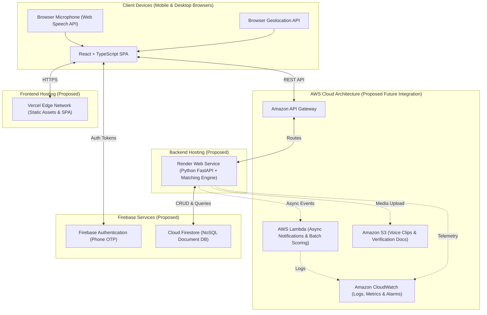

# Architecture Diagrams Index

All architecture and workflow diagrams in this repository are authored in **Mermaid** so they render natively on GitHub and remain version-controllable as plain text.

## Available Diagrams

| Diagram | Standalone `.mmd` Source | Accompanying Documentation | Purpose |
| :--- | :--- | :--- | :--- |
| **System Architecture** | [`diagrams/system-architecture.mmd`](../diagrams/system-architecture.mmd) | [`docs/system-architecture.md`](system-architecture.md) | Six-layer component architecture from UI & Voice down to Cloud & Database. |
| **User Workflow** | [`diagrams/user-workflow.mmd`](../diagrams/user-workflow.mmd) | [`docs/system-workflow.md`](system-workflow.md) | End-to-end Worker and Employer journeys with decision branches. |
| **Data Flow** | [`diagrams/data-flow.mmd`](../diagrams/data-flow.mmd) | [`docs/data-flow.md`](data-flow.md) | Producers, processors, and consumers across registration, matching, and application. |
| **Matching Process Pipeline** | [`diagrams/matching-process.mmd`](../diagrams/matching-process.mmd) | [`docs/data-flow.md`](data-flow.md) | Step-by-step request execution pipeline from user input to ranked results. |
| **Deployment Architecture** | [`diagrams/deployment-architecture.mmd`](../diagrams/deployment-architecture.mmd) | [`docs/cloud-infrastructure.md`](cloud-infrastructure.md) | Proposed Vercel, Render, Firebase, and AWS cloud topology. |

---

## Visual Overview: Deployment Topology

