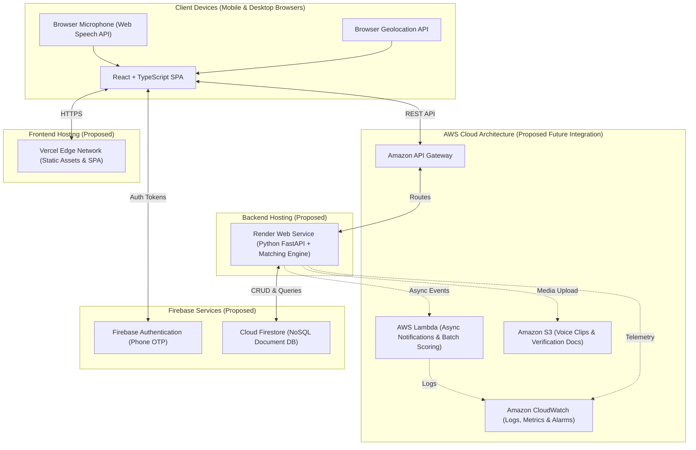

# Cloud Infrastructure & AWS Integration Plan (Proposed)

KaamConnect proposes a pragmatic, two-stage cloud architecture: a low-friction MVP deployment using **Vercel**, **Render**, and **Firebase**, paired with a scalable **AWS** architecture for production growth.

> **Status:** Proposed architecture and future integration plan only. No AWS resources, IAM roles, or live cloud deployments are configured in this repository.

---

## Deployment Architecture Diagram

Standalone Mermaid source: [`diagrams/deployment-architecture.mmd`](../diagrams/deployment-architecture.mmd)

---

## Proposed AWS Services & Responsibilities

| AWS Service | Proposed Role in KaamConnect | Why It Fits |
| :--- | :--- | :--- |
| **Amazon API Gateway** | Front-door API management, rate limiting, CORS enforcement, and request throttling. | Protects backend matching endpoints from abuse and provides a unified HTTPS endpoint. |
| **AWS Lambda** | Serverless event-driven processing (e.g., sending job-match alerts, periodic cleanup of expired jobs, async audio processing). | Zero idle cost for spiky hyper-local workloads. |
| **Amazon S3** | Durable object storage for optional worker ID/skill verification documents, profile photos, and cached TTS audio clips. | Keeps binary media out of Firestore documents. |
| **Amazon CloudWatch** | Centralized application logs, API latency metrics, error alarms, and matching-engine performance dashboards. | Enables proactive monitoring and faster incident triage. |

---

## MVP vs. Production Hosting Path

1. **MVP Stage:** Frontend on **Vercel**, FastAPI backend on **Render**, Auth + Data on **Firebase**. Fast iteration with minimal DevOps overhead.
2. **Production / Scale Stage:** Introduce **Amazon API Gateway**, **AWS Lambda**, **Amazon S3**, and **Amazon CloudWatch** to handle higher regional traffic, async notifications, and enterprise-grade observability.
