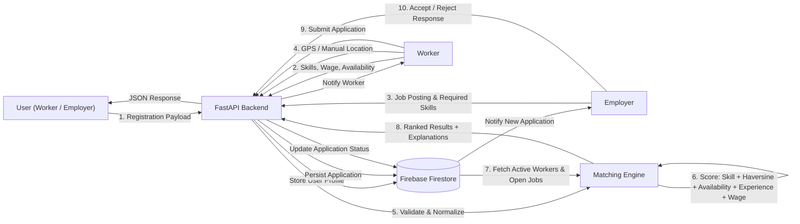
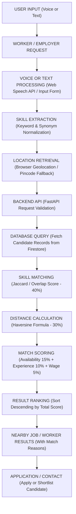

# Data Flow & Implementation Pipeline

This document explains how data moves through KaamConnect—from user input and location capture to matching engine execution and application updates.

---

## 1. System Data Flow

Standalone Mermaid source: [`diagrams/data-flow.mmd`](../diagrams/data-flow.mmd)

### Data Producers, Processors, and Consumers

| Stage | Producer | Processor | Consumer | Data Exchanged |
| :--- | :--- | :--- | :--- | :--- |
| **1. User Registration** | Worker / Employer UI | FastAPI Auth & Validation | Firebase Firestore (`users`) | `uid`, `full_name`, `phone`, `role`, `preferred_language` |
| **2. Worker Skill Submission** | Worker UI | FastAPI Worker Service | Firestore (`workers`) | `profession`, `skills[]`, `experience`, `expected_wage`, `availability` |
| **3. Employer Job Posting** | Employer UI | FastAPI Job Service | Firestore (`jobs`) | `title`, `required_skills[]`, `offered_wage`, `job_status` |
| **4. Location Collection** | Browser Geolocation / Manual Pin | FastAPI Geo Validator | Firestore (`workers` / `jobs`) | `latitude`, `longitude` |
| **5–7. Matching Execution** | FastAPI Matching Endpoint | Matching Engine | Firestore (Read) | Candidate records, coordinates, skill sets |
| **8. Matching Results** | Matching Engine | FastAPI Serializer | Worker / Employer UI | Ranked list with `total_score`, `distance_km`, `reasons[]` |
| **9–10. Application Lifecycle** | Worker UI / Employer UI | FastAPI Application Service | Firestore (`applications`) | `application_id`, `job_id`, `worker_id`, `application_status` |

---

## 2. Request Processing Pipeline

Standalone Mermaid source: [`diagrams/matching-process.mmd`](../diagrams/matching-process.mmd)

### Pipeline Walkthrough

1. **User Input & Request:** A worker taps the microphone (or types a query) to find jobs, or an employer posts a job seeking nearby workers.
2. **Voice / Text Processing:** If voice is used, the browser's Web Speech API transcribes audio into text in the user's selected language (Kannada, Hindi, or English).
3. **Skill Extraction:** The query parser normalizes trade keywords (e.g., *"wireman"* → `electrician`, `wiring`; *"tap repair"* → `plumbing`, `pipe_fitting`).
4. **Location Retrieval:** Latitude and longitude are attached from the Geolocation API or manual town selection.
5. **Backend API & Database Query:** FastAPI validates the request payload and queries open jobs or active workers from Firestore.
6. **Matching Engine Execution:** Each candidate pair is scored on skill overlap (40%), Haversine distance (30%), availability (15%), experience (10%), and wage compatibility (5%).
7. **Result Ranking & Action:** Results are sorted in descending order of total score and returned with human-readable explanations, enabling immediate application or candidate shortlisting.
