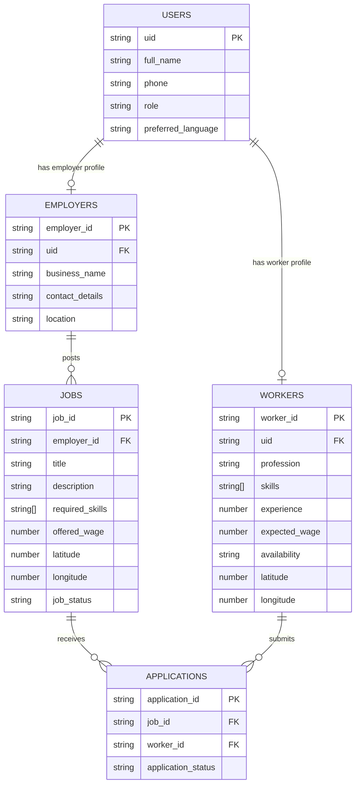

# Database Design (Proposed Firebase Firestore Schema)

KaamConnect proposes **Firebase Firestore** (NoSQL document database) to store user identities, worker trade profiles, employer profiles, job postings, and job applications.

> **Status:** Architecture specification only. No live Firebase project or Firestore instance is configured in this repository.

---

## Collection Relationship Diagram

---

## Collection Specifications

### 1. `users`
Stores core authentication and localization preferences for every registered user.

| Field | Type | Description |
| :--- | :--- | :--- |
| `uid` | `string` (PK) | Unique user ID generated by Firebase Authentication. |
| `full_name` | `string` | Display name of the worker or employer. |
| `phone` | `string` | E.164 formatted mobile number (e.g., `+919876543210`). |
| `role` | `string` | Enum: `"worker"` or `"employer"`. |
| `preferred_language` | `string` | ISO/locale code: `"kn"`, `"hi"`, or `"en"`. |

### 2. `workers`
Stores trade skills, daily-wage expectations, availability, and current coordinates.

| Field | Type | Description |
| :--- | :--- | :--- |
| `worker_id` | `string` (PK) | Unique document ID for the worker profile. |
| `uid` | `string` (FK) | References `users.uid`. |
| `profession` | `string` | Primary trade (e.g., `"electrician"`, `"plumber"`, `"mason"`). |
| `skills` | `array<string>` | Normalized skill tags (e.g., `["wiring", "inverter_install"]`). |
| `experience` | `number` | Years of practical trade experience. |
| `expected_wage` | `number` | Expected daily wage in INR (₹). |
| `availability` | `string` | Enum: `"available"`, `"busy"`, `"unavailable"`. |
| `latitude` | `number` | WGS84 latitude for Haversine matching. |
| `longitude` | `number` | WGS84 longitude for Haversine matching. |

### 3. `employers`
Stores local businesses, contractors, or household employers.

| Field | Type | Description |
| :--- | :--- | :--- |
| `employer_id` | `string` (PK) | Unique document ID for the employer profile. |
| `uid` | `string` (FK) | References `users.uid`. |
| `business_name` | `string` | Shop, contractor, or household name. |
| `contact_details` | `string` | Verified phone or alternate contact info (shared only upon match/acceptance). |
| `location` | `string` | Human-readable town/area label (e.g., `"Tumakuru, Karnataka"`). |

### 4. `jobs`
Stores hyper-local job opportunities posted by employers.

| Field | Type | Description |
| :--- | :--- | :--- |
| `job_id` | `string` (PK) | Unique document ID for the job posting. |
| `employer_id` | `string` (FK) | References `employers.employer_id`. |
| `title` | `string` | Short, clear job title (e.g., `"House Rewiring & MCB Setup"`). |
| `description` | `string` | Plain-language summary of work scope and duration. |
| `required_skills` | `array<string>` | Required skill tags matched against `workers.skills`. |
| `offered_wage` | `number` | Offered daily wage in INR (₹). |
| `latitude` | `number` | Job-site latitude. |
| `longitude` | `number` | Job-site longitude. |
| `job_status` | `string` | Enum: `"open"`, `"in_progress"`, `"filled"`, `"closed"`. |

### 5. `applications`
Tracks worker applications and employer hiring decisions.

| Field | Type | Description |
| :--- | :--- | :--- |
| `application_id` | `string` (PK) | Unique document ID for the application. |
| `job_id` | `string` (FK) | References `jobs.job_id`. |
| `worker_id` | `string` (FK) | References `workers.worker_id`. |
| `application_status` | `string` | Enum: `"pending"`, `"accepted"`, `"rejected"`, `"withdrawn"`. |

---

## Indexing & Query Strategy (Proposed)
- **Composite Index 1:** `jobs` on `(job_status, required_skills)` to quickly filter open listings before running Haversine distance scoring.
- **Composite Index 2:** `workers` on `(availability, profession)` to narrow candidate pools for urgent employer requests.
- **Geohash Extension (Future):** Adding a `geohash` field to `workers` and `jobs` will allow Firestore bounding-box pre-filtering as dataset size scales beyond single-town deployments.
