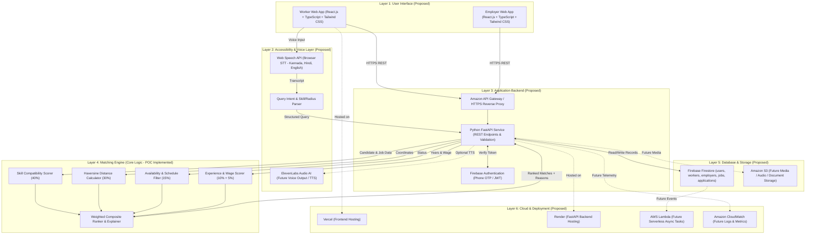

# System Architecture

KaamConnect follows a **six-layer modular architecture** designed for low-latency hyper-local matching, voice accessibility, and incremental cloud scalability.

> **Status:** Architectural specification. Only the **Layer 4 Matching Engine** logic has a working Python proof of concept in [`poc/matching_engine.py`](../poc/matching_engine.py). All other layers are proposed designs for the MVP and production phases.

---

## Architecture Diagram

Standalone Mermaid source: [`diagrams/system-architecture.mmd`](../diagrams/system-architecture.mmd)

---

## Layer-by-Layer Breakdown

### Layer 1: User Interface (Proposed)
- **Components:** Separate, role-tailored views for **Workers** (large icon-driven buttons, voice mic button, distance badges) and **Employers** (quick job posting form, candidate ranking cards).
- **Proposed Stack:** React.js, TypeScript, Tailwind CSS.
- **Design Principle:** Mobile-first responsive web app optimized for low-bandwidth 3G/4G connections in non-metropolitan areas.

### Layer 2: Accessibility & Voice Layer (Proposed)
- **Speech Input:** Browser-native **Web Speech API** (`SpeechRecognition`) captures spoken queries in Kannada (`kn-IN`), Hindi (`hi-IN`), or English (`en-IN`).
- **Query Parser:** Extracts trade profession, skills, and distance constraints (e.g., *"five kilometres"*) into structured API query parameters.
- **Future Audio Output:** **ElevenLabs** is proposed for optional text-to-speech playback of job summaries for workers with low reading literacy.

### Layer 3: Application Backend (Proposed)
- **Proposed Stack:** Python **FastAPI** behind an HTTPS gateway (Amazon API Gateway in the future AWS setup).
- **Responsibilities:** Request schema validation (Pydantic), Firebase JWT verification, role-based access control, and orchestrating calls to the Matching Engine and Firestore.

### Layer 4: Matching Engine (POC Implemented)
- **Responsibilities:** Deterministic, explainable scoring of worker–job pairs across five weighted dimensions:
  1. Skill compatibility (40%)
  2. Geographic proximity via Haversine formula (30%)
  3. Worker availability (15%)
  4. Relevant experience (10%)
  5. Wage compatibility (5%)
- **Implementation:** Demonstrated in [`poc/matching_engine.py`](../poc/matching_engine.py) with unit tests in [`poc/test_matching.py`](../poc/test_matching.py).

### Layer 5: Database & Storage (Proposed)
- **Primary Database:** **Firebase Firestore** storing `users`, `workers`, `employers`, `jobs`, and `applications` collections (see [Database Design](database-design.md)).
- **Object Storage (Future):** **Amazon S3** for optional profile photos, trade certificates, and cached voice audio clips.

### Layer 6: Cloud & Deployment (Proposed)
- **Frontend Hosting:** **Vercel** for global CDN edge delivery and instant preview deployments.
- **Backend Hosting:** **Render** for managed Python FastAPI containers during MVP, with an **AWS** migration/extension path using API Gateway, Lambda, S3, and CloudWatch (see [Cloud Infrastructure](cloud-infrastructure.md)).
