# System Workflow

This document details the end-to-end user journeys for **Workers** and **Employers**, including fallback paths for location permissions, empty search results, worker availability, and application decisions.

Standalone Mermaid source: [`diagrams/user-workflow.mmd`](../diagrams/user-workflow.mmd)

---

## End-to-End Workflow Diagram

```mermaid
flowchart TD
    subgraph Worker["Worker Flow"]
        W_START(["START"]) --> W_OPEN["Open KaamConnect"]
        W_OPEN --> W_REG["Register with Phone & Language"]
        W_REG --> W_SKILL["Select Skills, Wage & Availability"]
        W_SKILL --> W_LOC{"Location Permission Granted?"}
        W_LOC -->|Yes| W_GPS["Capture GPS Coordinates"]
        W_LOC -->|No| W_MANUAL["Enter Town / Pincode Manually"]
        W_GPS --> W_SEARCH["Search Jobs (Text or Voice)"]
        W_MANUAL --> W_SEARCH
        W_SEARCH --> W_MATCH["Matching Engine Evaluates Nearby Jobs"]
        W_MATCH --> W_FOUND{"Suitable Jobs Found?"}
        W_FOUND -->|No| W_EXPAND["Suggest Expanding Radius or Updating Skills"]
        W_EXPAND --> W_SEARCH
        W_FOUND -->|Yes| W_DISP["Display Ranked Nearby Jobs"]
        W_DISP --> W_SEL["Select Job & Review Details"]
        W_SEL --> W_AVAIL{"Worker Still Available?"}
        W_AVAIL -->|No| W_END(["END"])
        W_AVAIL -->|Yes| W_APPLY["Submit Application"]
        W_APPLY --> W_STATUS{"Application Accepted?"}
        W_STATUS -->|Accepted| W_CONTACT["Contact Employer Directly"]
        W_STATUS -->|Rejected / Pending| W_DISP
        W_CONTACT --> W_END
    end

    subgraph Employer["Employer Flow"]
        E_START(["START"]) --> E_REG["Register"]
        E_REG --> E_PROF["Create Employer Profile"]
        E_PROF --> E_POST["Post Job"]
        E_POST --> E_SKILLS["Enter Required Skills & Offered Wage"]
        E_SKILLS --> E_LOC{"Location Permission Granted?"}
        E_LOC -->|Yes| E_GPS["Auto-Detect Job Site Coordinates"]
        E_LOC -->|No| E_PIN["Pin Job Location Manually"]
        E_GPS --> E_MATCH["Matching Engine Scores Nearby Workers"]
        E_PIN --> E_MATCH
        E_MATCH --> E_FOUND{"Matching Workers Available?"}
        E_FOUND -->|No| E_WAIT["Keep Listing Open & Notify Nearby"]
        E_FOUND -->|Yes| E_DISP["Display Ranked Nearby Workers"]
        E_DISP --> E_REV["Review Applications"]
        E_REV --> E_DEC{"Accept Worker?"}
        E_DEC -->|Yes| E_SEL["Select Worker & Share Contact"]
        E_DEC -->|No| E_REV
        E_SEL --> E_END(["END"])
        E_WAIT --> E_END
    end
```

---

## Key Decision Branches Explained

1. **Location Permission Granted vs. Denied**
   - **Granted:** The browser Geolocation API supplies precise latitude and longitude.
   - **Denied:** The user is never blocked; KaamConnect falls back to a town, locality, or pincode selector mapped to approximate centroid coordinates.
2. **Suitable Jobs / Workers Found vs. Not Found**
   - **Found:** Results are sorted by composite match score and presented with distance (km) and match explanations.
   - **Not Found:** Workers are prompted to widen the search radius (e.g., 5 km → 15 km) or add secondary skills; employers keep the job open for incoming matches.
3. **Worker Available vs. Unavailable**
   - Workers can toggle availability (`available`, `busy`, `unavailable`). Unavailable workers are deprioritized or excluded from urgent same-day job recommendations.
4. **Application Accepted vs. Rejected**
   - **Accepted:** Contact details are exchanged so the worker and employer can coordinate directly by phone.
   - **Rejected / Pending:** The worker can immediately continue browsing other nearby ranked opportunities.
